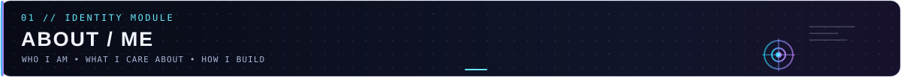
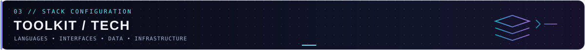
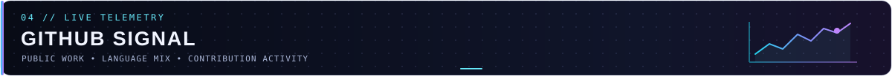

<!--
  MANAS VARADE | Developer command center
  All project capabilities and technologies below are based on repository files.
-->

<p align="center">
  
</p>

<p align="center">
  
</p>

<p align="center">
  
</p>

<p align="center">
  <a href="https://github.com/V-MANAS?tab=repositories">EXPLORE REPOSITORIES</a>
  &nbsp; · &nbsp;
  <a href="https://www.linkedin.com/in/manas-varade-239a9b2a3/">LINKEDIN</a>
  &nbsp; · &nbsp;
  <a href="mailto:manasvarade4002@gmail.com">EMAIL</a>
</p>

---

<h2 align="center">
  
</h2>

```yaml
name: Manas Varade
role: Final-year Computer Engineering student
interests:
  - Full-stack web development
  - Backend engineering and API design
  - AI-powered developer tools
  - Software architecture and problem-solving
approach: Build deliberately. Understand the system. Improve through iteration.
```

I like building software end to end: shaping an interface, designing APIs and data models, and solving the edge cases that make systems more dependable.

<h2 align="center">
  
</h2>

<table>
  <tr>
    <td width="50%" valign="top">
      <h3><a href="https://github.com/V-MANAS/RankPilot-AI-SEO-Analyser">01 · RankPilot</a></h3>
      <p><strong>AI-powered SEO analytics</strong></p>
      Website audits covering SEO, performance and accessibility; AI-generated recommendations; competitor comparisons; keyword rank tracking; historical dashboards; and downloadable PDF reports. Uses a multi-strategy scraping pipeline with Browserbase, local Playwright, and an HTTP parser fallback.
      <br /><br />
      <sub>React · TypeScript · Node.js · Express · MongoDB · Playwright · Browserbase · Gemini</sub>
      <br /><br />
      <a href="https://github.com/V-MANAS/RankPilot-AI-SEO-Analyser">VIEW REPOSITORY ↗</a>
    </td>
    <td width="50%" valign="top">
      <h3><a href="https://github.com/V-MANAS/DevFlow-AI">02 · DevFlow AI</a></h3>
      <p><strong>Project management & collaboration</strong></p>
      Organizes workspaces, projects and tasks with workspace roles (`OWNER`, `ADMIN`, `MEMBER`), JWT authentication, bcrypt password hashing, role-aware authorization, task dependencies, comments and activity tracking.
      <br /><br />
      <sub>React · Vite · Node.js · Express · PostgreSQL · Prisma · JWT · RBAC</sub>
      <br /><br />
      <a href="https://github.com/V-MANAS/DevFlow-AI">VIEW REPOSITORY ↗</a>
    </td>
  </tr>
  <tr>
    <td width="50%" valign="top">
      <h3><a href="https://github.com/V-MANAS/QuickShow">03 · QuickShow</a></h3>
      <p><strong>Movie discovery & ticket booking</strong></p>
      A React/Vite movie experience with movie and show browsing, movie details, favorites, date selection and admin-oriented UI components. The server uses Express, MongoDB/Mongoose, Clerk middleware and Inngest integration.
      <br /><br />
      <sub>React · Vite · Tailwind CSS · Node.js · Express · MongoDB · Clerk · Inngest</sub>
      <br /><br />
      <a href="https://github.com/V-MANAS/QuickShow">VIEW REPOSITORY ↗</a>
    </td>
    <td width="50%" valign="top">
      <h3>04 · Engineering focus</h3>
      <p><strong>Learn by building</strong></p>
      Exploring backend architecture, practical API design, system reliability and the fundamentals behind the code—not just the surface-level implementation.
      <br /><br />
      <sub>Design · Build · Debug · Review · Improve</sub>
    </td>
  </tr>
</table>

<h2 align="center">
  
</h2>

<p>
  
</p>

<p><strong>Languages & UI</strong><br />C++ · JavaScript · TypeScript · React · Vite · Tailwind CSS</p>
<p><strong>Backend & data</strong><br />Node.js · Express · MongoDB · PostgreSQL · Prisma · Redis</p>
<p><strong>Engineering tools</strong><br />Git · GitHub · Playwright · Browserbase · Google Gemini · Docker</p>

<sub>Technologies are drawn from the project repositories and engineering work described here; not every tool appears in every project.</sub>

<h2 align="center">
  
</h2>

<p align="center">
  
  
</p>

<p align="center">
  
</p>

<sub>These cards request live public data from external services. They may load slowly or be unavailable during third-party outages; no statistics are hard-coded here.</sub>

### 05 / CURRENT MISSION

Build useful projects, get sharper with data structures and algorithms, and deepen the computer science fundamentals that lead to clear, reliable engineering.

<p align="center"></p>

<p align="center"><code>while (learning) { build(); review(); repeat(); }</code></p>

<p align="center"></p>

<p align="center"><sub>Thanks for stopping by — explore the code, follow the experiments, and keep building.</sub></p>
