  

  

  <a href="https://github.com/V-MANAS?tab=repositories">EXPLORE REPOSITORIES</a>
  &nbsp;·&nbsp;
  <a href="https://www.linkedin.com/in/manas-varade-239a9b2a3/">LINKEDIN</a>
  &nbsp;·&nbsp;
  <a href="mailto:manasvarade4002@gmail.com">EMAIL</a>

---

### 01 / ABOUT

<pre>
name: Manas Varade
role: Final-year Computer Engineering student
focus:
  - Full-stack web development
  - Backend engineering and API design
  - AI-powered developer tools
  - Software architecture and problem-solving
now: Building projects and sharpening computer science fundamentals
</pre>

I enjoy turning practical problems into useful software, from thoughtful interfaces to the APIs and data models behind them.

### 02 / SELECTED BUILDS

<table>
  <tr>
    <td width="50%" valign="top">
      <strong><a href="https://github.com/V-MANAS/RankPilot-AI-SEO-Analyser">RankPilot</a></strong> 
      AI-assisted SEO analysis with website audits, competitor comparisons, keyword tracking, dashboards, and PDF reports.
        
      React · TypeScript · Express · MongoDB · Playwright · Gemini
    </td>
    <td width="50%" valign="top">
      <strong><a href="https://github.com/V-MANAS/DevFlow-AI">DevFlow AI</a></strong> 
      A project and collaboration platform with workspace roles, project and task workflows, task dependencies, and activity tracking.
        
      React · Node.js · Express · PostgreSQL · Prisma
    </td>
  </tr>
  <tr>
    <td width="50%" valign="top">
      <strong><a href="https://github.com/V-MANAS/MovieBookingSystem-QuickShow">QuickShow</a></strong> 
      A movie ticket booking platform with show browsing, seat selection, Stripe checkout, digital tickets, and an admin dashboard.
        
      React · Node.js · Express · MongoDB · Clerk · Stripe
    </td>
    <td width="50%" valign="top">
      <strong>Currently exploring</strong> 
      Backend systems, dependable APIs, and the engineering choices that make software easier to extend.
        
      Design · Build · Review · Improve
    </td>
  </tr>
</table>

### 03 / TOOLKIT

  

Also used in project work: Playwright, Browserbase, and Google Gemini.

### 04 / GITHUB SIGNAL

  
  

  

Statistics are generated from public GitHub data by the linked services and may be unavailable during service outages.

### 05 / CURRENT MISSION

Building projects, improving at data structures and algorithms, and strengthening the computer science fundamentals behind the code.

<code>while (learning) { build(); review(); repeat(); }</code>

